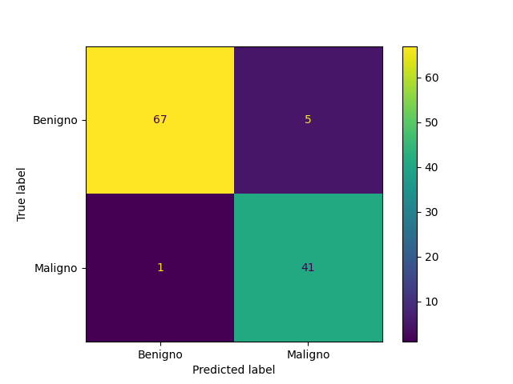
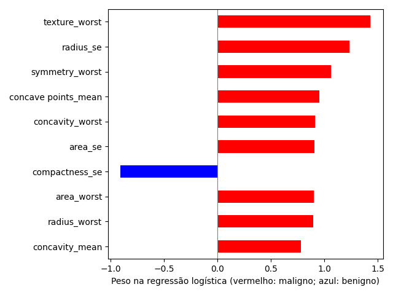
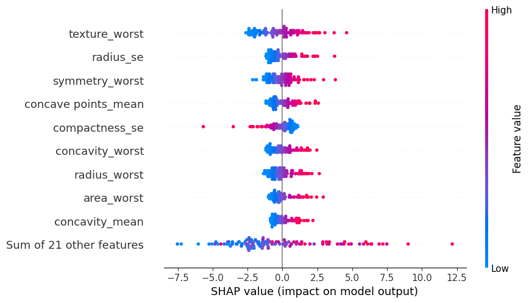
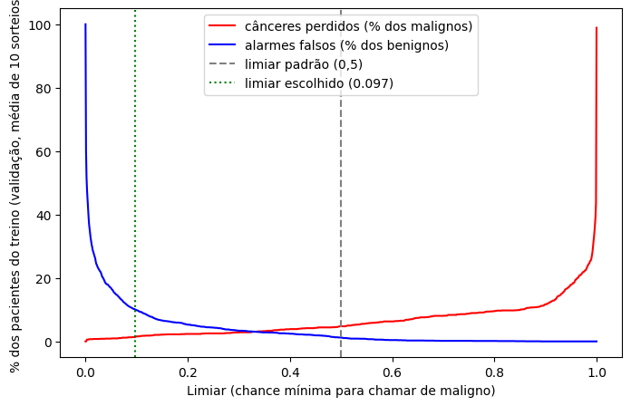
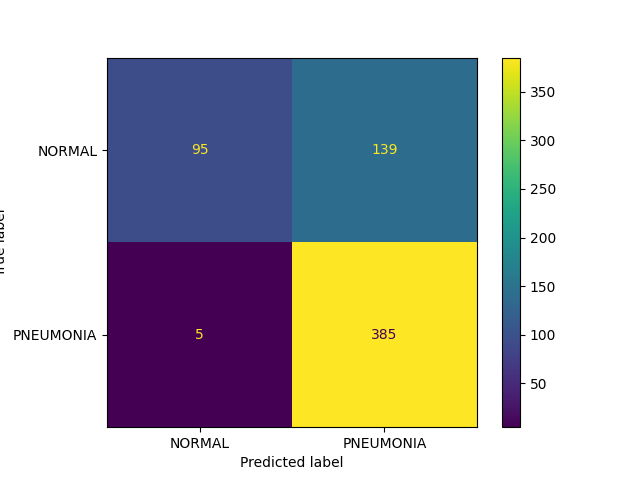
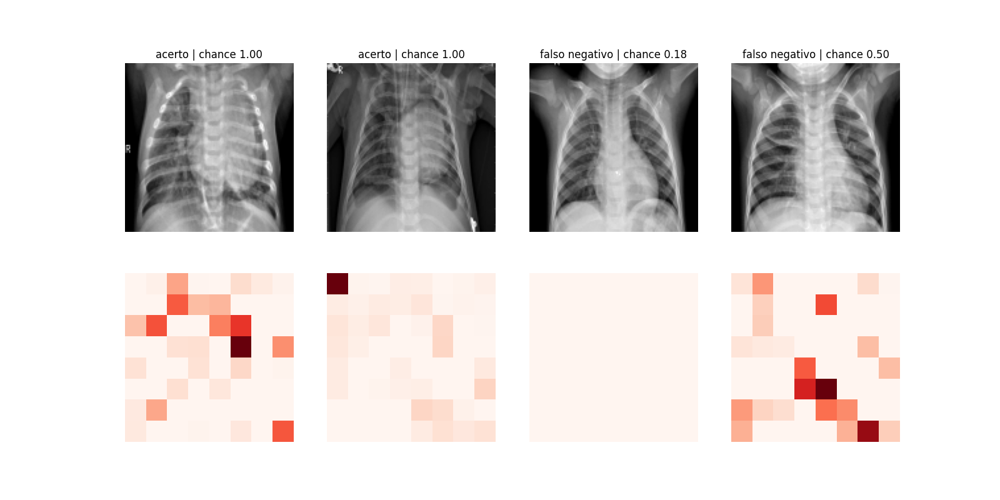

# Tech Challenge Fase 1 — Apoio ao diagnóstico com Machine Learning

Pós-Tech **IA para Devs** (FIAP) · Fase 1

| Notebook | Abrir |
| --- | --- |
| Parte A: câncer de mama | [](https://colab.research.google.com/github/gabrielrb/tech-challenge-fase1/blob/main/diagnostico_cancer_mama.ipynb) |
| Parte B (EXTRA): pneumonia | [](https://colab.research.google.com/github/gabrielrb/tech-challenge-fase1/blob/main/diagnostico_pneumonia.ipynb) |

**Relatório técnico:** [relatorio_tecnico.pdf](relatorio_tecnico.pdf)

> **Aviso:** este é um projeto acadêmico. Os modelos apoiam a triagem de exames e não substituem o diagnóstico. A decisão final é sempre do médico.

## Sumário

- [O projeto](#o-projeto)
- [Resultados](#resultados)
- [Como foi feito](#como-foi-feito)
- [Como executar](#como-executar)
- [Estrutura do repositório](#estrutura-do-repositório)
- [Bases de dados](#bases-de-dados)
- [Tecnologias](#tecnologias)
- [Limitações](#limitações)
- [Integrantes](#integrantes)

## O projeto

Um hospital universitário quer um sistema de apoio ao diagnóstico para acelerar a triagem de exames. O sistema classifica cada exame como "doente" ou "não doente" e aponta os casos suspeitos para o médico olhar primeiro.

| Parte | Problema | Dados | Modelos comparados |
| --- | --- | --- | --- |
| A | câncer de mama: maligno ou benigno | 569 pacientes, 30 medidas do núcleo das células (tabela) | regressão logística, KNN, SVM, Árvore de Decisão e Random Forest |
| B (EXTRA) | pneumonia no raio-X de tórax | 5.856 radiografias de crianças | 2 redes neurais convolucionais (CNN) e PCA + Random Forest |

**Métrica principal: recall da classe doente.** O erro mais grave é o falso negativo, ou seja, dizer que um doente está saudável. O recall mede quantos doentes o modelo encontra. A precisão, o F1, a acurácia e a AUC ficam como métricas de apoio.

**Regra de decisão da Parte A:** perder um câncer é pelo menos 10 vezes pior do que um alarme falso, que só leva a mais exames. Por isso, o modelo e o limiar de decisão foram escolhidos pelo menor custo = 10 × cânceres perdidos + alarmes falsos, na validação. O recall sozinho não basta, porque chamar todos de malignos daria recall 1,0. O 10 é uma escolha do grupo, e não de um estudo: a equipe médica deve rever esse número.

**Uso na prática:** os exames acima do limiar de decisão sobem na fila do médico (na Parte A, basta uma chance de câncer de 9,7%). O médico continua revendo todos os exames e decide.

## Resultados

Resultados no conjunto de teste, que só foi usado no fim, depois da escolha do modelo (na Parte A, veja também a nota de transparência). Os números da Parte A foram gerados com o scikit-learn 1.6.1: em outra versão, alguns números podem mudar um pouco.

| Parte | Problema | Modelo final | Recall da classe doente | Outras métricas |
| --- | --- | --- | --- | --- |
| A | câncer de mama (tabela) | regressão logística, limiar 0,097 | 0,98 (41 de 42 cânceres) | 5 alarmes falsos em 72 benignos · acurácia 0,95 · precisão 0,89 · F1 0,93 · AUC 0,996 |
| B | pneumonia (raio-X) | CNN 2 | 0,99 (385 de 390 pneumonias) | recall de NORMAL 0,41 · AUC 0,896 |

### Parte A: câncer de mama

Cada modelo dá uma chance de câncer para cada paciente. Na validação (validação cruzada de 5 partes no treino, repetida com 10 sorteios), procuramos para cada modelo o limiar com o menor custo = 10 × cânceres perdidos + alarmes falsos.

| Modelo | Limiar de menor custo | Cânceres perdidos (de 170) | Alarmes falsos (de 285) | Custo |
| --- | --- | --- | --- | --- |
| Regressão logística | 0,097 | 2,3 | 28,6 | 51,6 |
| SVM | 0,127 | 3,1 | 21,6 | 52,6 |
| Random Forest | 0,271 | 4,0 | 22,5 | 62,5 |
| KNN | 0,001 | 3,1 | 41,4 | 72,4 |
| Árvore de Decisão | 0,001 | 16,7 | 17,8 | 184,8 |

Valores médios dos 10 sorteios. No custo, a regressão logística e o SVM ficaram num empate técnico: com outros sorteios, o SVM fica na frente muitas vezes. A regressão logística foi escolhida por dois motivos. Primeiro, na regra do grupo, ela perde menos cânceres (2,3 contra 3,1 de 170), que é o erro mais grave; o SVM só empata no custo porque dá menos alarmes falsos. Segundo, ela é mais simples de explicar: cada medida tem um peso. O ajuste do C manteve o valor padrão (C = 1). O PCA aumentou o custo e ficou de fora. O limiar exato importa pouco: entre 0,08 e 0,20, o custo quase não muda. O importante é que ele seja baixo, perto de 0,1.

No teste, com o limiar de 0,097, o modelo encontrou **41 dos 42 cânceres** e deu **5 alarmes falsos** em 72 benignos. Com o limiar padrão de 0,5, teriam sido 3 cânceres perdidos. O câncer perdido tem medidas típicas de tumor benigno, como mostra o SHAP.

**Transparência:** numa primeira versão, o modelo era um Random Forest com limiar de 0,5, que perdeu 3 cânceres no teste. O grupo não achou isso aceitável e não seguiu com essa versão. Ela também mostrou no teste o efeito de baixar o limiar. Foram esses resultados que levaram à regra de custo, ou seja, o teste já tinha sido visto. Por isso, o modelo, o C e o limiar novos foram escolhidos só com a validação, e o modelo novo foi testado uma única vez.

<p align="center">
  
  
</p>

As medidas que mais pesam formam grupos: textura, tamanho do núcleo (raio e área), concavidade e simetria. Valores altos empurram para maligno, o que combina com a análise de correlação. O **SHAP** mostra a direção de cada medida e explica a decisão de cada paciente.

<p align="center">
  
</p>

**O preço do limiar.** Baixar o limiar pega mais cânceres, mas gera mais alarmes falsos:

| Limiar | Cânceres perdidos no teste | Alarmes falsos no teste |
| --- | --- | --- |
| padrão (0,5) | 3 de 42 | 1 de 72 |
| escolhido pelo custo (0,097) | 1 de 42 | 5 de 72 |
| zero perdidos na validação (0,001) | 0 de 42 | 40 de 72 |

Os primeiros cânceres saem baratos (cerca de 4 alarmes por câncer, na validação); os últimos custariam cerca de 62 alarmes cada. Mesmo com peso 50, o limiar de menor custo seria 0,063: o "zero perdidos" só venceria com peso 85 ou mais. E nem ele garante zero em pacientes novos. O limiar final deve ser revisto com a equipe médica.

<p align="center">
  
</p>

### Parte B: pneumonia

A validação foi separada por paciente: as radiografias de uma mesma criança ficam todas no treino ou todas na validação. Assim, a rede não é avaliada com crianças que já viu.

O notebook compara as 3 soluções na validação e escolhe sozinho o modelo final, antes de olhar o teste. A regra: descarta os modelos com recall de NORMAL abaixo de 0,80 e, entre os demais, fica com o maior recall de PNEUMONIA. Se dois ficarem a até 0,02 um do outro, vence o de maior recall de NORMAL.

A regra escolheu a CNN 2. No teste, ela encontrou 385 das 390 pneumonias, mas acertou só 41% dos exames normais (139 alarmes falsos). Na validação, esse acerto era de 95%: a validação não mostrou a queda. Por isso, o modelo de imagens ainda precisa melhorar antes de qualquer uso.

<p align="center">
  
  
</p>

O mapa de oclusão cobre um pedaço da imagem por vez e mede quanto a certeza de pneumonia cai. Cada raio-X (em cima) tem o seu mapa embaixo: quanto mais forte o vermelho, mais aquele quadrado pesou para PNEUMONIA.

## Como foi feito

| Etapa | Parte A: câncer de mama | Parte B: pneumonia |
| --- | --- | --- |
| Exploração | estatísticas descritivas, contagem das classes, histogramas, boxplot e correlação | contagem das classes, exemplos, imagem média e brilho de cada classe |
| Pré-processamento | remove `id` e `Unnamed: 32`; alvo com LabelEncoder (maligno = 1); padronização dentro de um Pipeline | tons de cinza, 128 × 128 pixels, valores entre 0 e 1; pneumonia = 1 |
| Divisão | 80% treino e 20% teste, estratificado; validação cruzada KFold de 5 partes no treino, repetida com 10 sorteios | pasta `test` como teste (624 imagens); validação de cerca de 20% tirada do treino, separada por paciente e estratificada |
| Modelos | regressão logística, KNN, SVM, Árvore e Random Forest; teste com PCA; ajuste do C da regressão logística | CNN 1 (3 convoluções); CNN 2 (128 filtros, um pooling a mais e Dropout); PCA + Random Forest |
| Avaliação | limiar escolhido pelo custo na validação; matriz de confusão, recall, precisão, F1, curva ROC e AUC | recall das 2 classes, matriz de confusão, curva ROC e AUC |
| Interpretação | pesos da regressão logística (importância das variáveis), SHAP e a troca do limiar de decisão | grade de acertos e erros e mapa de oclusão |

Os detalhes e as justificativas de cada escolha estão no [relatório técnico](relatorio_tecnico.pdf) e nos textos dos próprios notebooks.

## Como executar

### Opção 1: Google Colab (recomendado)

Não precisa instalar nada.

1. Clique no botão **Open in Colab** da parte que quer rodar, na tabela do topo desta página. Se aparecer o aviso de que o notebook não foi criado pelo Google, clique em **Executar mesmo assim**.
2. Na Parte B, ligue a GPU: **Ambiente de execução → Alterar o tipo de ambiente de execução → T4 GPU → Salvar** (em inglês: *Runtime → Change runtime type → T4 GPU → Save*).
3. Rode tudo: **Ambiente de execução → Executar tudo** (em inglês: *Runtime → Run all*).

| Parte | Tempo aproximado | Dados |
| --- | --- | --- |
| A | poucos minutos | o `data.csv` é lido deste repositório |
| B | 15 a 30 minutos, com GPU | o notebook baixa a base do Kaggle (cerca de 2,5 GB) |

### Opção 2: Docker

Requer o [Docker](https://docs.docker.com/get-docker/) instalado. O `docker build` leva alguns minutos, porque instala o TensorFlow.

```bash
git clone https://github.com/gabrielrb/tech-challenge-fase1.git
cd tech-challenge-fase1
docker build -t tech-challenge .
docker run --rm -p 127.0.0.1:8888:8888 tech-challenge
```

Abra <http://localhost:8888>, entre no notebook e use **Run → Run All Cells**. Para encerrar, aperte `Ctrl + C` no terminal.

- O Jupyter do contêiner abre sem senha. Por isso, o `127.0.0.1` deixa a porta acessível só no seu computador.
- O que você muda no notebook fica dentro do contêiner e some quando ele é encerrado.
- No Docker, a Parte B roda na CPU. Num computador com 2 núcleos, sem GPU, ela inteira levou cerca de 17 minutos, já contando o download da base.
- Sem GPU, os números das CNNs mudam um pouco em relação ao Colab. No nosso teste no Docker, a CNN 2 encontrou 388 das 390 pneumonias, e o recall de NORMAL foi 0,37 (no Colab: 385 e 0,41). A escolha do modelo e a conclusão são as mesmas.

**Docker no navegador (GitHub Codespaces):** no GitHub, clique em **Code → Codespaces → Create codespace on main**. O repositório já vem aberto. No terminal do Codespace, rode só os dois últimos comandos acima (`docker build` e `docker run`). Quando aparecer o aviso da porta 8888, clique em **Open in Browser**.

### Opção 3: no computador, sem Docker

Requer Python 3.13, a mesma versão do Colab e do Dockerfile. Em Mac com processador Intel, o TensorFlow 2.21 não instala: use o Colab ou o Docker.

Linux ou macOS:

```bash
git clone https://github.com/gabrielrb/tech-challenge-fase1.git
cd tech-challenge-fase1
python3.13 -m venv .venv
source .venv/bin/activate
pip install -r requirements.txt
jupyter lab
```

Windows (PowerShell):

```powershell
git clone https://github.com/gabrielrb/tech-challenge-fase1.git
cd tech-challenge-fase1
py -3.13 -m venv .venv
.venv\Scripts\Activate.ps1
pip install -r requirements.txt
jupyter lab
```

O `requirements.txt` traz as mesmas versões de bibliotecas do Colab. Ele foi gerado pela seção B13 do notebook da Parte B.

### Problemas comuns

| Problema | O que fazer |
| --- | --- |
| A Parte B mostra `GPU: DESLIGADA` | ligue a GPU (passo 2 da opção 1) e rode de novo |
| O Colab diz que não há GPU disponível | o limite de uso grátis de GPU foi atingido: rode sem GPU (mais lento) ou tente mais tarde |
| O download do Kaggle pede login | crie um token em kaggle.com → **Settings → API**. No Colab, salve-o como segredo `KAGGLE_API_TOKEN`. No Docker, use `docker run --rm -p 127.0.0.1:8888:8888 -e KAGGLE_API_TOKEN=seu_token tech-challenge` |
| A Parte A abre uma janela para escolher um arquivo | o notebook não achou o `data.csv` no GitHub: escolha o `data.csv` baixado deste repositório |
| O PowerShell diz que a execução de scripts está desabilitada | rode `Set-ExecutionPolicy -Scope Process -ExecutionPolicy Bypass` e repita o `Activate.ps1` (vale só para aquela janela) |

## Estrutura do repositório

```text
tech-challenge-fase1/
├── diagnostico_cancer_mama.ipynb   # Parte A: notebook com as saídas
├── diagnostico_pneumonia.ipynb     # Parte B (EXTRA): notebook com as saídas
├── data.csv                        # base da Parte A
├── figuras/                        # gráficos das Partes A e B, usados no relatório
├── relatorio_tecnico.pdf           # relatório técnico
├── requirements.txt                # bibliotecas e versões do Colab
├── Dockerfile                      # ambiente para rodar fora do Colab
├── .dockerignore                   # arquivos que o Docker ignora
├── .gitignore                      # arquivos que o Git ignora
└── README.md                       # este arquivo
```

## Bases de dados

| Parte | Base | Tamanho | Fonte |
| --- | --- | --- | --- |
| A | Breast Cancer Wisconsin (Diagnostic) | 569 pacientes: 357 benignos e 212 malignos | [Kaggle](https://www.kaggle.com/datasets/uciml/breast-cancer-wisconsin-data) · [UCI](https://doi.org/10.24432/C5DW2B) |
| B | Chest X-Ray Images (Pneumonia) | 5.856 radiografias: 1.583 NORMAL e 4.273 PNEUMONIA | [Kaggle](https://www.kaggle.com/datasets/paultimothymooney/chest-xray-pneumonia) · [Mendeley Data](https://doi.org/10.17632/rscbjbr9sj.3) |

A base da Parte B vem do artigo de Kermany et al. (2018), *Identifying Medical Diagnoses and Treatable Diseases by Image-Based Deep Learning*, Cell 172(5). DOI [10.1016/j.cell.2018.02.010](https://doi.org/10.1016/j.cell.2018.02.010).

## Tecnologias

| Uso | Ferramentas |
| --- | --- |
| Linguagem e ambiente | Python 3.13, Google Colab, Jupyter Lab |
| Dados e gráficos | pandas, NumPy, Matplotlib, seaborn |
| Machine Learning | scikit-learn, SHAP |
| Imagens e redes neurais | OpenCV, TensorFlow / Keras |
| Base da Parte B | kagglehub |
| Execução fora do Colab | Docker, GitHub Codespaces |

## Limitações

- **Parte A:** o modelo ainda deixou passar 1 de 42 cânceres no teste, e com só 42 cânceres a taxa real pode ser maior (até cerca de 13%, com 95% de confiança). O limiar baixo gera alarmes falsos (5 de 72 no teste). A base é pequena e vem de um único centro, nos EUA. Nela, 37% são malignos; no hospital, essa proporção pode mudar a precisão e o melhor limiar.
- **Parte B:** a base tem só crianças de 1 a 5 anos, de um único hospital na China. O modelo não vale para adultos nem para outros aparelhos sem um novo teste. No teste, o recall de NORMAL caiu de 0,95 (validação) para 0,41: o modelo ainda dá alarmes falsos demais.
- **As duas partes:** antes de qualquer uso real, os modelos precisam ser testados com dados do próprio hospital. O limiar de decisão deve ser definido com a equipe médica.

## Integrantes

| Perfil |
| --- |
| [GitHub: @gabrielrb](https://github.com/gabrielrb) |
| [GitHub: @Macedole](https://github.com/Macedole) |
| [GitHub: @gomezllari](https://github.com/gomezllari) |
| [LinkedIn: lucas-germano-f](https://www.linkedin.com/in/lucas-germano-f-20913a101/) |
